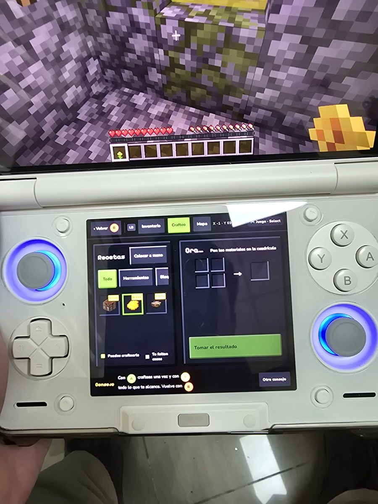
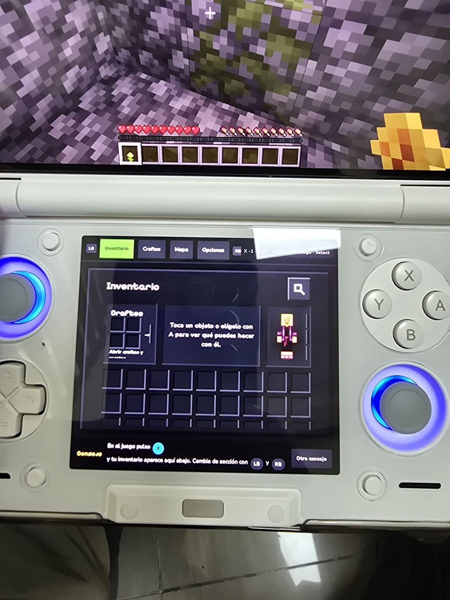

# Biomeria Launcher

Un launcher de Minecraft para consolas Android de 1 y 2 pantallas, pensado para jugar con mando. Reúne tres motores en un solo lugar, cada uno con su bioma:

| Bioma | Motor | Estado |
|---|---|---|
| 🌲 Bosque | Minecraft Java (Fabric, mods, shaders) | Disponible |
| 🌊 Océano | Minecraft Bedrock (app oficial) | Próximamente |
| 🔥 Nether | Starling (motor nativo en Rust) | Próximamente |

## Características

### Inicio
La pantalla principal es **Mis mundos**: cada mundo es una instancia con su versión y su motor. Un banner grande muestra el bioma del mundo elegido, con el botón de jugar, favorito y editar. Debajo, las tarjetas de tus mundos, con filtro por bioma (L1 / R1 con mando), favoritos, búsqueda y orden. Todo se maneja con mando, con las pistas de botones siempre visibles abajo.

### Intro y pantalla de carga
- **Intro**: la primera vez que abres Biomeria te recibe una introducción corta donde eliges tu primer paso (crear un mundo de Java, abrir Bedrock o explorar) y, si quieres, iniciar sesión.
- **Pantalla de carga**: un splash con la marca de Biomeria mientras arranca la app.

### Estadísticas
Biomeria cuenta cuánto juegas, solo mientras el juego está en pantalla.
- Filtros de **7 días, 30 días y todo**.
- Tiempo jugado, sesiones, logros y tu día más jugado.
- Gráfico de barras por día y tiempo por mundo.
- Se guardan en el propio dispositivo; si el juego se cierra de golpe, igual se rescata la sesión.
- Las estadísticas se pueden **compartir con frontends** (ver [docs/frontends.md](docs/frontends.md)).

### Logros
Biomeria recoge los avances de Minecraft que consigues (logros, metas y desafíos) y los muestra con un marco distinto según su tipo, más una celebración al desbloquearlos. Hay una pestaña para los de cada mod. Los que aún no tienes solo se cuentan, no se muestran, para no arruinar la sorpresa.

### Pantalla inferior (doble pantalla)
En consolas de dos pantallas, la de abajo muestra inventario, crafteo, mapa y opciones, con consejos que puedes mover de esquina, quitar o hacer más chicos. El tamaño de la interfaz es ajustable.

### Mapa
- En consolas de una pantalla, un **mapa flotante** en la esquina que eliges (tamaño, zoom, marcas y coordenadas ajustables).
- Con Select se abre el **mapa grande**: mueves el mapa con los sticks, acercas con R2, alejas con L2, marcas con A.

### Taller y Jugar juntos
- **Taller**: mods, shaders y paquetes de recursos desde Modrinth, con las dependencias a la vista; importa modpacks .mrpack.
- **Jugar juntos**: abre tu mundo en tu red o por internet con una sala temporal.

### Galería
Las capturas que sacas en Minecraft (tecla F2) aparecen dentro de la app, juntas por mundo: cuadrícula, vista grande con LB / RB y botones para compartir o borrar.

### Guía
Una pantalla dentro de la app que explica qué hace cada botón del mando (en el juego, pantalla de abajo, mapa grande y launcher) y cómo se usa cada parte de Biomeria.

### Cuentas
Sin conexión, Microsoft o Ely.by. Guías: [Microsoft](docs/cuentas-microsoft-java.md) · [Ely.by](docs/cuentas-ely-by.md).

### Integración con frontends
Biomeria se puede abrir y consultar desde frontends como **Cocoon, iiSU y Díptico**: catálogo de mundos, estadísticas y lanzamiento por enlace. Detalles en [docs/frontends.md](docs/frontends.md).

## Galería

| Crafteo en la pantalla de abajo | Inventario en la pantalla de abajo |
|---|---|
|  |  |

*Biomeria en una AYN Thor: el juego arriba, el panel de Biomeria abajo.*

## Instalación
Descarga el APK de la sección de [Releases](../../releases). Los APK están firmados con la misma llave, así que cada versión se instala encima de la anterior.
